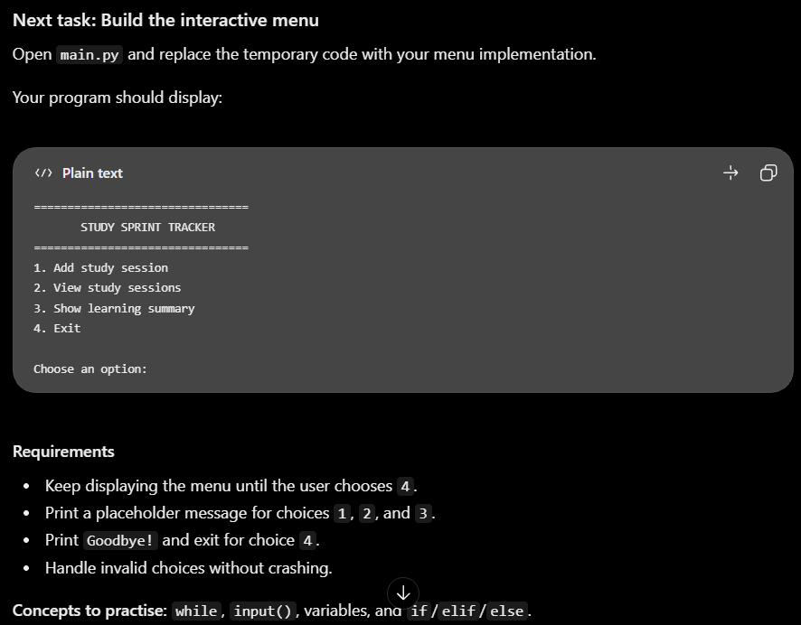
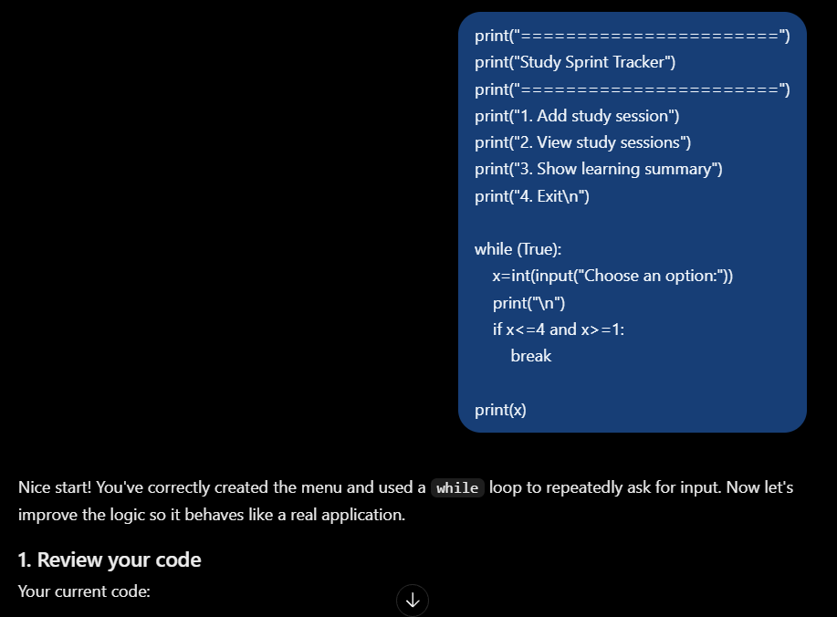
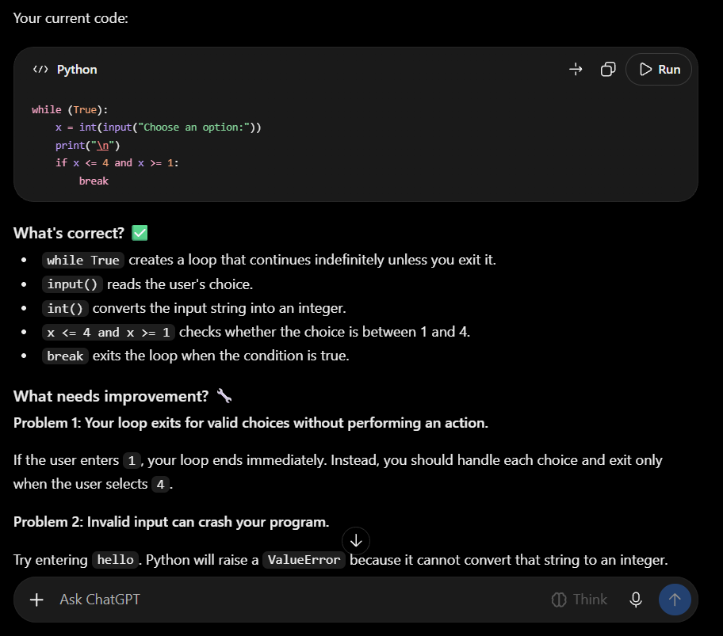

# Study Sprint Tracker Cli

Hello everyone this is my first project in phantom, almost after 1 year of break i lost all my knowledge in programming, so sad that i have forgotton who i was before 1 year so this is my chance to gain my skills back after 1 year.

I'm starting this journey where i planned not to use ai in this entire event and planned to code all by myself, in this event today [27 October 2026] i started my goal is to lockin 6 hours per day and learn to become a full-stack developer where chatgpt is going to be my mentor to help me to learn the topics and will act as my code reviewer {only for this project where im starting to learn from scratch}.

Kindly support me along my journey.

## What my project does.

A command line application for recording study sessions, tracking time spent on different topics and reviewing your progress.

## why i made this project.

this project help me to learn fundamentals of python, introduction cli and a small refreshment to my python knowledge where i start to code from scratch.

## How to Run this project.

```
git clone https://github.com/lucks-13/study-sprint-tracker.git
```
```
python main.py
```
## How i made this project.

this is a simple starting project, i got inspiration from chatgpt it told like it will be the best starting point.

here is reference image.



and my response.





# Ai Disclosure
i used ai to guide me on building this project and explicitly told to help me only when i got stuck.
95 to 99 % of the code is Human coding. the ai just gave me instruction when i got struck.